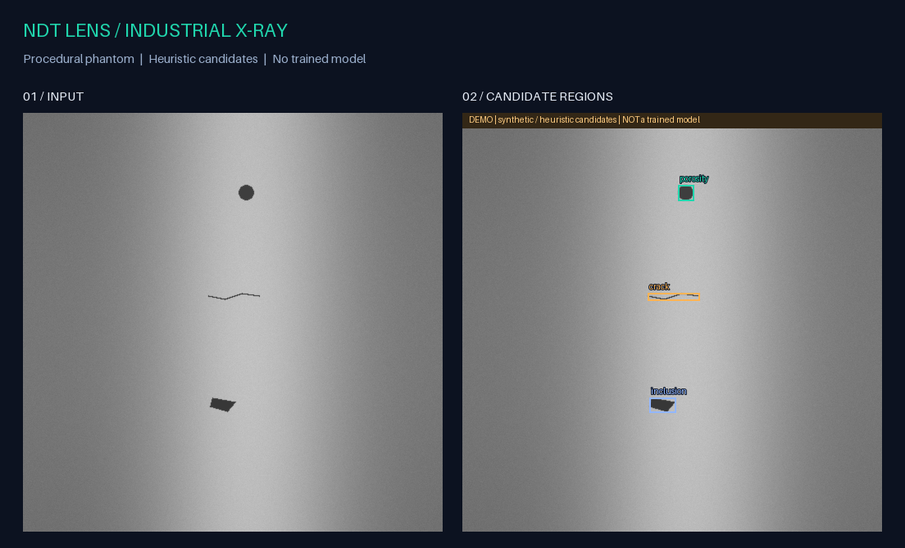
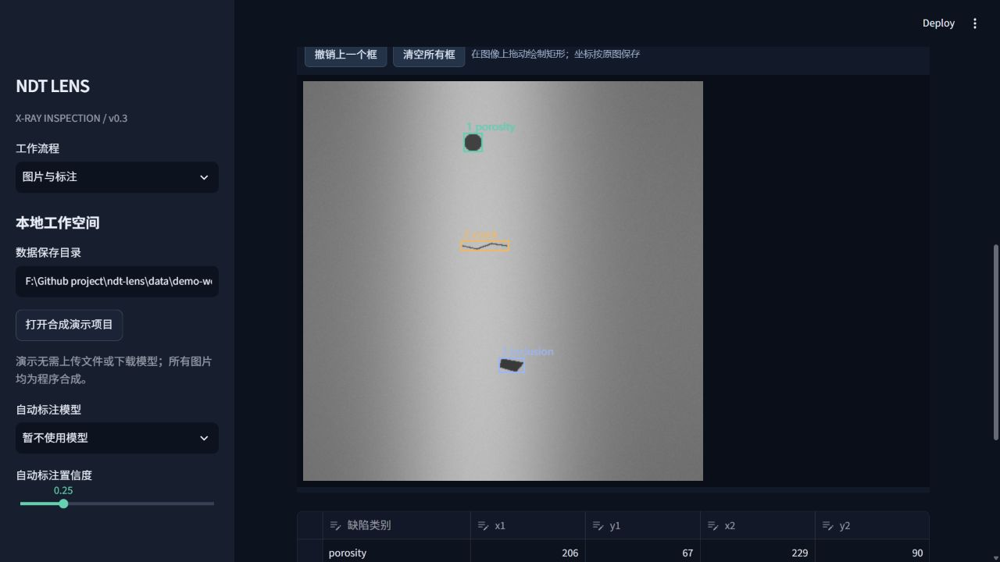
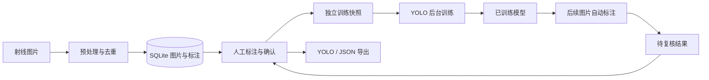

<div align="center">

# NDT Lens

**工业射线缺陷检测与人机协同标注工作台**

从第一张人工标注，到后续图片的自动标注与复核。

[](https://github.com/perceivedreality11-cyber/ndt-lens/actions/workflows/checks.yml)


[](LICENSE)

[快速体验](#快速体验) · [使用手册](docs/USAGE.md) · [系统设计](docs/ARCHITECTURE.md) · [实验记录](docs/EXPERIMENTS.md) · [English](README.en.md)

</div>



*上图由仓库代码生成：程序合成图像 + 形态学候选定位，不是实拍底片或深度学习预测。*

## 项目解决什么问题

工业缺陷检测既需要模型，也需要可靠的标注和数据管理。NDT Lens 将图片导入、矩形标注、人工确认、YOLO 训练、自动标注和复核串联为一个可运行的本地流程。初始检测类别为 **气孔、裂纹、夹杂**。

项目重点是计算机视觉的工程落地：将模型输出转成可编辑、可追溯的标注，并通过数据隔离与人工复核形成下一轮训练样本。

<details>
<summary>查看实际运行的标注界面（合成演示项目）</summary>



</details>

> **当前阶段：研究与工程演示。** 支持真实图片接入，但仓库没有真实工业数据训练结果，也不提供工件合格判定。合成实验的设置、原始指标和局限均单独记录。

## 快速体验

推荐 Python 3.10–3.12，无需 GPU 即可体验标注与候选检测。

```bash
git clone https://github.com/perceivedreality11-cyber/ndt-lens.git
cd ndt-lens
python -m venv .venv
```

Windows：

```powershell
.\.venv\Scripts\python.exe -m pip install -e ".[ui,dev]"
.\.venv\Scripts\python.exe -m streamlit run app.py
```

macOS / Linux：

```bash
source .venv/bin/activate
python -m pip install -e ".[ui,dev]"
python -m streamlit run app.py
```

打开终端中的本地地址后：

1. 点击侧栏 **打开合成演示项目**：生成 15 张图，含 12 张预置合成真值和 3 张待标注图片。
2. 在 **图片与标注** 拖动画框、修改表格、保存草稿或确认标注。演示数据与真实工作空间分开保存。
3. 安装训练依赖 `python -m pip install -e ".[train]"` 后，进入 **训练中心**。演示项目默认 1 轮、128 边长、CPU、从零初始化，无需下载预训练权重。
4. 训练成功后选择侧栏模型，打开 **批量自动标注**；也可勾选新图片导入后立即自动标注。修正并确认后即可用于下一轮训练。

默认测试不下载权重，也不启动训练。首次安装依赖需要联网；完整训练需安装 PyTorch / Ultralytics。

## 已实现能力

| 环节 | 实现 | 工程细节 |
|---|---|---|
| 图片入库 | PNG / JPEG / TIFF / BMP 批量导入 | 保存原始字节；统一 PNG；按像素哈希去重 |
| 人工标注 | 自定义 Canvas 框选、缩放、类别及坐标编辑 | SQLite 持久化；版本校验避免静默覆盖 |
| 数据治理 | 工件/底片分组、正常样本、标注与泄漏检查 | 同组不跨 train / val / test；仅确认样本进入训练 |
| 深度学习 | YOLO11 训练、验证、独立 test 评估 | 支持 CPU / CUDA；每次训练使用独立数据快照 |
| 训练任务 | 后台进程、状态、日志、验证曲线 | 页面切换不打断训练；进程退出可识别为失败 |
| 自动标注 | 现有图片批处理、新图片导入后推理 | 记录模型来源；自动结果待复核；保护已确认标注 |
| 数据导出 | 可搬移的 YOLO 数据集、JSON、标注图 | 原图与画框预览分离；默认筛选已确认样本 |
| 工程验证 | 单元测试、Streamlit 页面测试、CI、wheel 构建 | 覆盖负样本、越界框、重复预测、导出往返等边界 |

## 系统结构



核心约束：**预测不会自动成为训练真值；未确认结果不进入训练；已确认标签不会被批量推理覆盖。** 设计取舍与状态流转见 [系统设计](docs/ARCHITECTURE.md)。

## 实验与验证

仓库提供可复现的 **传统形态学基线 vs. YOLO11n** 合成数据实验，分别报告固定阈值下的 Precision / Recall / F1，以及 YOLO 官方 test mAP。脚本会记录参数、随机种子和运行环境。

```bash
python -m pip install -e ".[train]"
python scripts/run_experiment.py --output outputs/my-experiment --epochs 100 --count 120 --size 256 --seed 2026
```

每次使用新的输出目录，避免覆盖旧实验。验证集用于选择 `best.pt`，测试集用于该次训练的独立评估。合成实验不代表真实焊缝的泛化能力；完整结果与失败分析见 [实验记录](docs/EXPERIMENTS.md)。

实际运行：120 张合成图、84/18/18 划分、100 轮 CPU 训练，合成 test mAP50 **0.9950**、mAP50–95 **0.7566**。传统方法在固定 IoU 下 F1 为 **0.9888**，YOLO 为 **1.0000**。这是简单合成分布上的 18 张 test 图，不能表述为真实工业准确率；早期较差的实验也完整保留。

```bash
ruff format --check .
ruff check .
pytest -q
```

CI 配置覆盖 Windows / Linux 与 Python 3.10 / 3.12。已执行结果见 [验证记录](docs/VALIDATION.md)；线上实际状态以 Actions 为准。

## 代码导航

```text
app.py                    Streamlit 入口
src/ndt/
  imaging.py              图像读取与高位深灰度窗
  detection.py            传统候选检测、YOLO 适配、可视化
  workspace.py            图片库、标注状态、分组与快照
  box_editor/             原生 Canvas 标注组件
  jobs.py                 后台训练与进程状态
  export.py               可搬移的数据集与结果导出
  evaluation.py           IoU 与类别感知的一对一匹配
  demo.py                 独立合成演示项目
  cli.py                  数据检查、训练、评估与推理命令
scripts/run_experiment.py  可复现实验入口
tests/                    核心逻辑与界面回归测试
docs/                     系统设计、实验、操作与项目讲解
```

[真实数据接入与命令行](docs/USAGE.md) · [贡献指南](CONTRIBUTING.md) · [项目讲解与简历素材](docs/PORTFOLIO.md)

## 适用范围与后续方向

当前定位是本机单用户的矩形目标检测工作台。已知限制包括：固定三类缺陷、TIFF 只读取首帧、无 DICOM/超声序列处理；高位深图转换为 8 位会丢失绝对灰度信息；图片哈希不能替代相似底片及采集分组审查。

后续优先接入有授权的真实数据，评估小缺陷漏检、不同工件与成像条件的泛化，并研究高分辨率切片检测与不确定性采样。后续方向尚未实现。

## 许可证

[AGPL-3.0-only](LICENSE)。Ultralytics 及其模型遵循各自许可。项目数据、模型权重、数据库与运行产物不纳入 Git；示例图片由本仓库程序生成。
