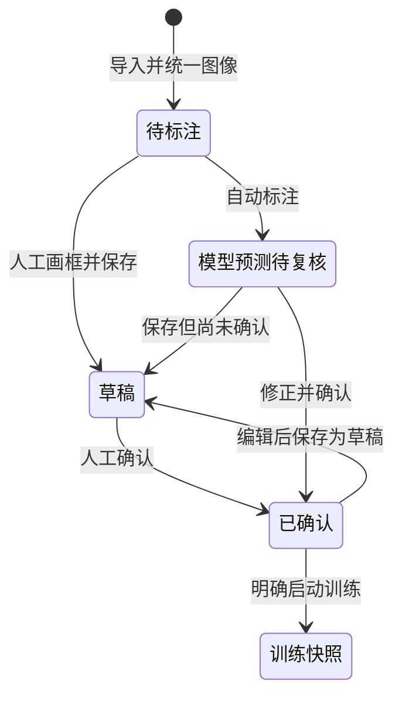
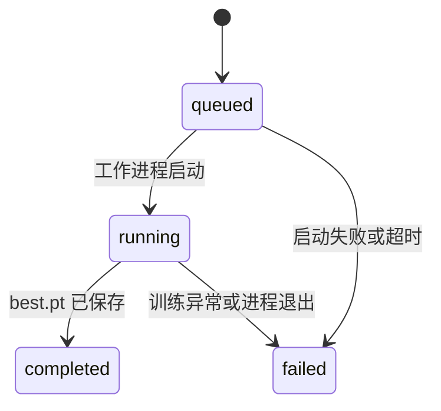

# 系统设计

NDT Lens 是本机单用户的图像标注与目标检测工作台。模型负责生成候选标注，使用者负责确认训练真值；项目没有把自动预测直接当作经过人工确认的数据。

## 分层与职责

| 层 | 模块 | 职责 |
|---|---|---|
| 交互 | `app.py`、`workbench_ui.py`、`box_editor/` | 页面流程、画布、表格编辑、操作反馈 |
| 工作空间 | `workspace.py`、`demo.py` | 持久化、组号与划分、版本、演示数据 |
| 模型与图像 | `imaging.py`、`detection.py` | 一致预处理、传统基线、YOLO 加载与推理 |
| 任务执行 | `jobs.py` | 子进程启动、状态、退出检查、日志、参数与环境 |
| 交换与评估 | `export.py`、`evaluation.py`、`dataset.py` | YOLO 数据、合法性检查、IoU 匹配、结果导出 |
| 复现 | `cli.py`、`scripts/run_experiment.py` | 无界面的操作入口与独立实验 |

UI 调用服务模块，持久化和评估逻辑可在没有浏览器的环境中测试。自定义框选组件使用原生 Canvas 和 Streamlit 组件消息协议，不需要前端构建工具。

## 标注状态



数据库用 `reviewed`、`model`、`boxes` 表达这些状态，避免两个重复状态字段产生不一致。空框列表有两种含义：`reviewed=0` 表示尚未确认，`reviewed=1` 才表示确认后的负样本。自动预测为零框时，也保持待复核。

每次标注更新递增 `revision`，保存使用 `WHERE id=? AND revision=?`；版本不匹配时拒绝写入，防止旧页面悄悄覆盖新标注。自动标注也使用同一检查，并跳过所有已确认图片。

## 数据与可追溯性

```text
workspace/
  workspace.sqlite       图片属性、分组、划分、标注 JSON、模型来源、版本
  workspace.json         可选的演示来源说明
  originals/<id>.bin     原始上传字节；原文件名保存在数据库
  images/<id>.png        EXIF 校正/高位深转换后的统一图像
  snapshots/<uuid>/     该次训练的图片、标签、配置及 manifest
  jobs/<run-id>/         job.json、process.json、environment.json、train.log、result/
```

图片 ID 为统一 RGB 像素与尺寸的 SHA-256，不依赖上传文件名，因此重命名或不同编码的相同像素不会重复入库。导入事务中检查组号，禁止同一工件/底片组跨集合。

哈希只能发现完全相同的像素，不能发现缩放、裁剪或相邻曝光的近似重复。因此数据采集时仍需按原始工件/底片建立正确组号。合成演示的每张图使用独立种子，不替代真实采集分组策略。

高位深灰度图采用 1–99% 百分位窗转为 8 位。界面标注、训练快照和推理共用这条变换，保证框与像素空间一致；原始字节单独保留，以便后续研究其他窗宽窗位或高位深模型。

## 训练任务与失败处理

训练前复制已确认样本到新快照，验证 train / val 非空、训练正样本、标签和重复像素。训练过程中继续编辑工作空间，不会改变该次快照。

后台任务通过 `subprocess.Popen` 启动同一 Python 环境的 `ndt.jobs`，参数通过本地 JSON 记录，不拼接 shell 命令。Windows 进程隐藏启动，页面重跑不终止训练。工作空间启动锁防止同时启动两个训练，运行记录按以下状态流转：



状态文件通过临时文件替换，降低读到半份 JSON 的风险。读取运行状态时同时核对 PID 和进程启动时间，避免 PID 被系统复用后误报仍在运行。失败记录保留错误和日志，可重新启动新的任务；当前不提供跨机器任务调度、断点续训按钮或强制取消。

## 导出约定

默认仅导出确认样本，`images/<split>` 中保存没有覆盖框的统一图像，`labels/<split>` 保存归一化 YOLO 标签，`annotated/<split>` 仅用于展示。相对路径 `dataset.yaml` 可随 ZIP 搬移；解压后使用 `ndt check-data` 验证。

`manifest.json` 保留原名、组号、划分、复核状态、模型来源与版本；`workspace.json` 保留合成来源说明。若显式导出未复核预测，报告和 manifest 仍标注该状态。

## 评估约定

- 使用 val 选择 `best.pt`，test 在该次训练结束后独立运行。
- 固定 IoU=0.5 和推理置信度下，按类别做一对一匹配。重复预测计 FP，错误类别分别产生 FP 与 FN，负图上的预测也计 FP。
- 固定阈值 Precision / Recall / F1 与置信度扫描的 AP 是不同指标，结果文件分开命名，不把它们混为“准确率”。
- 传统基线使用局部灰度差和形状规则，不输出模型置信度；不把它伪装成深度学习结果。

## 当前取舍

选择 Streamlit 是为了让数据、模型和 UI 在 Python 环境中快速连通；选择 SQLite 是为了让个人使用和项目复现不依赖数据库服务。后台任务采用子进程，满足本机训练场景。

多人协作、权限、审计、队列调度和大规模数据管理不在本版本范围。如果扩展到团队服务，需要将用户身份、存储权限、任务队列和模型注册独立设计。当前界面不应直接暴露到无认证的公网。
