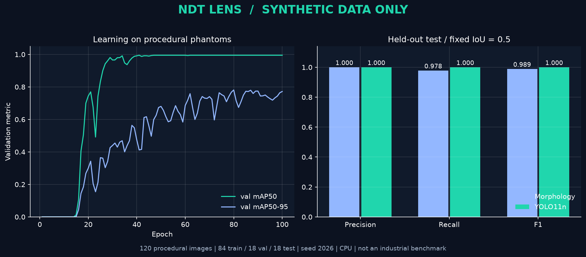

# 实验记录：合成数据，不代表真实工业效果

本页记录 2026-10-15 在 Windows、Python 3.14.6、CPU 上实际执行的实验。数据全部来自 `ndt.synthetic` 的程序生成器，模型从 `yolo11n.yaml` 随机初始化，未使用通用预训练权重。

## 主要实验

```bash
python scripts/run_experiment.py --output outputs/experiment-100e --epochs 100 --count 120 --size 256 --seed 2026
```

| 项目 | 实际设置 |
|---|---|
| 数据 | 120 张独立种子合成灰度图，256×256 |
| 划分 | train 84 / val 18 / test 18 |
| 负样本 | train 16 / val 5 / test 3 |
| test 缺陷 | 45 个框，每类 15 个 |
| 模型 | YOLO11n，随机初始化，无预训练下载 |
| 训练 | 100 epochs，batch 8，CPU，seed 2026，workers 0 |
| 选模 | 使用 val 选择 `best.pt` |
| 固定阈值评估 | test，IoU=0.5；YOLO confidence=0.25 |
| 实验耗时 | 187.6 秒，包含训练、验证、test 和固定阈值评估；不是部署延迟基准 |



### 同一 test 集的固定阈值对比

| 方法 | TP | FP | FN | Precision | Recall | F1 |
|---|---:|---:|---:|---:|---:|---:|
| 传统灰度差 + 形状规则 | 44 | 0 | 1 | 1.0000 | 0.9778 | 0.9888 |
| YOLO11n，conf=0.25 | 45 | 0 | 0 | 1.0000 | 1.0000 | 1.0000 |

传统方法漏掉一个裂纹框；在该阈值下，YOLO 匹配到全部 45 个合成真值框。上述是 micro 指标，不是图像分类准确率。

### YOLO 官方独立 test 评估

| 指标 | 数值 |
|---|---:|
| mAP50 | 0.9950 |
| mAP50–95 | 0.7566 |
| 官方 Precision | 0.9895 |
| 官方 Recall | 1.0000 |

官方评估的阈值扫描、选取的 operating point 和浮点框与本项目固定置信度、整数像素框匹配不同，因此 Precision 不要求与上一表相同。表中 mAP 只来自官方评估，不对无置信度的形态学结果编造 AP。

证据文件：

- [完整指标与环境 JSON](experiments/synthetic-100e.json)
- [逐轮训练与验证 CSV](experiments/synthetic-100e-history.csv)
- [执行脚本](../scripts/run_experiment.py)
- [绘图脚本](../scripts/plot_experiment.py)

JSON 的 `ndt-lens` 包版本为 null：该次实验从源码路径启动，当时没有可读取的已安装发行元数据。其他依赖版本按实际环境记录。运行时产生的数据和权重不纳入 Git，可通过上方命令重新生成；不同硬件或依赖版本可能产生不同数值。

## 早期短训练与失败分析

保留了 [30 轮实验原始记录](experiments/synthetic-30e.json)：60 张图、seed 42、42/9/9 划分、256 边长，test mAP50 为 0.0383，固定 confidence=0.25 时没有预测框。它说明流程能执行并不等于模型已经学会检测。

30 轮和 100 轮实验的数据量及种子均不同，不能把差异当作“只增加训练轮数”的消融结论。主要实验在新种子和新划分上执行，最终模型由 val 选择；两次 test 结果都保留，避免只展示较好的一次。

## 结果能够说明什么

- 图像生成、数据检查、训练、权重加载、test 评估、固定阈值匹配和结果记录能够连通。
- YOLO 能拟合这一简单的程序合成分布。
- 传统方法在该分布上也非常强，深度学习的改进仅为这 18 张 test 图中的一个匹配框，不能推断统计显著优势。

## 结果不能说明什么

- 不能声称真实焊缝检测“99.5% 准确率”，也不能据此决定工件合格。
- 生成器使用暗缺陷和简单几何，传统基线直接利用这些假设；复杂背景、散射、成像条件和真实缺陷形态没有被覆盖。
- 小样本单次划分缺少置信区间、多随机种子和真实分布外验证。
- 本实验没有证明小目标切片、半监督学习、主动学习或现场部署性能；这些尚未实现。

真实数据实验建议按 [实验模板](EXPERIMENT_TEMPLATE.md) 记录工件/底片来源和分组，在独立 test 集评估每类漏检及误报，再讨论实际效果。
